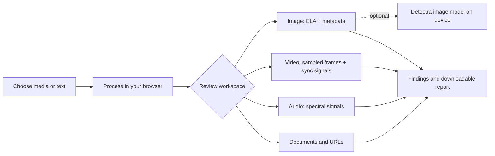

<div align="center">

# 🛡️ DeepGuard AI

### A browser-based workspace for reviewing suspicious media

Inspect images, video, audio, documents, and URLs with local signal analysis, metadata checks, and an optional on-device image model.


</div>

> **Use findings as clues, not a verdict.** DeepGuard produces review signals. It does not prove that media is authentic, AI-generated, or manipulated.

---

## What you can review

| Workspace | What it checks |
| --- | --- |
| 🎞️ **Video** | Samples frames, examines visual signals, and compares lower-face motion with speech timing. |
| 🎙️ **Audio** | Uses browser audio analysis to inspect spectral and voice signals. |
| 🖼️ **Images** | Shows JPEG recompression (ELA) signals, metadata, and an optional AI-image model score. |
| 📄 **Documents** | Reviews supported PDF, DOCX, and text content for stylometric indicators. |
| 🔗 **URLs** | Checks URL structure and common risk indicators. |
| 🔐 **Verification** | Calculates SHA-256 hashes, reviews metadata and C2PA indicators, and creates reports. |

## How a review works



### Image model at a glance

- **Model:** [Detectra v3 on Hugging Face](https://huggingface.co/TensorFold/detectra-v1), pinned to a fixed revision in the app.
- **Download:** about **43.7 MB**, fetched when needed and normally cached by the browser.
- **Runtime:** ONNX Runtime Web; WebGPU where supported, with a WebAssembly fallback.
- **Cost:** no hosted inference endpoint and no per-image API token usage. The tradeoffs are download size, browser memory, and local compute.
- **Meaning:** a model score is not a calibrated probability. Its benchmark results are reported by the model author and may not generalize to every source or new generator.

The classifier is optional. If its model or runtime cannot load, the app can still show available local ELA and metadata signals and labels the model result unavailable.

## Run locally

You need a modern browser and Python 3, or another static HTTP server. From the project folder, run:

```bash
python -m http.server 8000
```

Open [http://localhost:8000](http://localhost:8000). Serving over `localhost` also enables browser features that require a secure context, such as microphone and camera capture.

The app is a static site; there is no build step or application server. It loads its visual libraries and optional model files from public CDNs, so network access is needed for those resources. Once the page and required resources are available, media analysis runs in the browser.

## Privacy and limitations

- Media is processed in browser memory and is not sent to a DeepGuard backend.
- Public CDN requests load page libraries and optional model assets. The model weights are downloaded to your browser; uploaded media is not sent to Hugging Face for inference.
- Scan history is stored in browser storage on the current device.
- ELA differences, metadata presence or absence, audio signals, and model scores can all be affected by ordinary editing, compression, recording, and sharing.
- No single indicator establishes provenance or intent. Use independent evidence for high-impact decisions.

## Project layout

```text
.
├── index.html                 # Complete static application
├── README.md                  # Project guide
└── .github/workflows/static.yml  # GitHub Pages deployment workflow
```

## Deployment

The repository includes a GitHub Actions workflow for deploying the static files to GitHub Pages when changes are pushed to `main`. Enable GitHub Pages for the repository with **GitHub Actions** as the deployment source; the first deployment then appears in the workflow run and Pages settings.

---

<div align="center">

**DeepGuard AI helps you investigate media. It cannot replace careful verification.**

</div>

