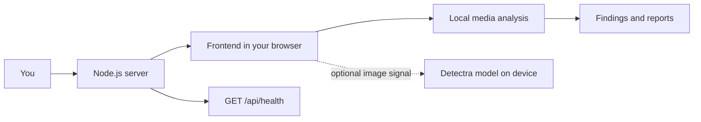

<div align="center">

# 🛡️ DeepGuard AI

### A browser-based workspace for reviewing suspicious media

Inspect images, video, audio, documents, and URLs with local signal analysis, metadata checks, and an optional on-device image model.


</div>

> **Use findings as clues, not a verdict.** DeepGuard produces review signals. It does not prove that media is authentic, AI-generated, or manipulated.

---

## Project map

```text
deepguard-ai/
├── frontend/
│   ├── index.html                 # App structure and screens
│   ├── css/
│   │   └── styles.css             # Custom styles
│   └── js/
│       ├── tailwind-config.js     # Theme configuration
│       └── app.js                 # Browser analysis and interface
├── backend/
│   ├── server.js                  # Static server and health endpoint
│   ├── package.json               # Start command; zero dependencies
│   └── README.md                  # Backend setup and endpoint
├── .github/workflows/static.yml   # GitHub Pages frontend deployment
├── .gitignore
└── README.md
```

## What you can review

| Workspace | What it checks |
| --- | --- |
| 🎞️ **Video** | Samples frames, examines visual signals, and compares lower-face motion with speech timing. |
| 🎙️ **Audio** | Uses browser audio analysis to inspect spectral and voice signals. |
| 🖼️ **Images** | Shows JPEG recompression (ELA) signals, metadata, and an optional AI-image model score. |
| 📄 **Documents** | Reviews supported PDF, DOCX, and text content for stylometric indicators. |
| 🔗 **URLs** | Checks URL structure and common risk indicators. |
| 🔐 **Verification** | Calculates SHA-256 hashes, reviews metadata and C2PA indicators, and creates reports. |

## How the pieces fit together



The backend serves the frontend and provides a small health endpoint. Media analysis remains in the browser; the backend does not accept uploaded media or call a hosted model.

## Run the full app locally

You need **Node.js 18 or newer**. The backend uses only Node's built-in modules.

```bash
cd backend
npm start
```

Open [http://127.0.0.1:3000](http://127.0.0.1:3000). Check the backend at [http://127.0.0.1:3000/api/health](http://127.0.0.1:3000/api/health). Set `PORT` to change the port; use `HOST=0.0.0.0` only when another machine needs to reach the service.

You can also run the frontend on its own using a static server:

```bash
cd frontend
python -m http.server 8000
```

Then open [http://localhost:8000](http://localhost:8000). `localhost` enables browser features that require a secure context, such as microphone and camera capture.

## Optional image model

- **Model:** [Detectra v3 on Hugging Face](https://huggingface.co/TensorFold/detectra-v1), pinned to a fixed revision in the app.
- **Download:** about **43.7 MB**, fetched when needed and normally cached by the browser.
- **Runtime:** ONNX Runtime Web; WebGPU where supported, with a WebAssembly fallback.
- **Inference cost:** no hosted endpoint and no per-image API token usage. The tradeoffs are download size, browser memory, and local compute.
- **Meaning:** a model score is not a calibrated probability. Benchmark results are reported by the model author and may not generalize to every source or new generator.

If model files cannot load, the app still shows available local ELA and metadata findings and marks the model result unavailable.

## Privacy and limitations

- Media is processed in browser memory and is not sent to a DeepGuard backend.
- The browser loads page libraries and optional model assets from public CDNs. Uploaded media is not sent to Hugging Face for inference.
- Scan history is stored in browser storage on the current device.
- ELA differences, metadata, audio signals, and classifier scores can be affected by editing, compression, recording, and sharing.
- No single indicator establishes provenance or intent. Use independent evidence for high-impact decisions.

## Deployment

The included GitHub Actions workflow deploys the **frontend** folder to GitHub Pages when `main` is updated. Select **GitHub Actions** as the Pages deployment source in repository settings. GitHub Pages hosts static files only; deploy the Node.js backend separately if you later need it reachable online.

---

<div align="center">

**DeepGuard AI helps you investigate media. It cannot replace careful verification.**

</div>
